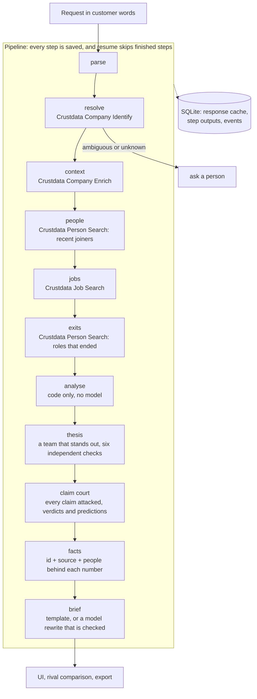

# Market Universe

**Type your company. Market Universe finds your rivals, who is heading where you are heading, and who fell, from live hiring data, with every number sourced.**

Built overnight at ContextCon 04, IIT Kanpur (theme: Services, Replaced), on Crustdata's people, company and job data.

## The service
- **The job it replaces:** competitive-intelligence research. Someone on a strategy or corporate-development team (or a consultant on a competitor study) opens profiles one by one, copies titles into a spreadsheet, guesses which team each person is on, and repeats it next quarter. It is slow, so it is done for one or two rivals a year and goes stale.
- **Who pays today:** strategy and corp-dev teams at fintechs, banks and funds, and consulting firms that sell competitor studies. We did not research current fees, so this README makes no price claim.
- **A customer request:** "Which teams at Groww are growing fastest, and what does it say about what they will invest in next?" The finished work is a one-page brief with sources, plus the evidence behind each number.

## What it does now
1. Reads the request and resolves the company to one record. Ambiguity stops the run and asks (25 records are literally named "Groww"; "Groww Inc" is a different 2-10 person company; typos are accepted but flagged as assumed).
2. Pulls everyone whose current role started in the last 12 months (Person Search), the headcount series and leaders (Company Enrich), and open roles (Job Search).
3. **Removes re-recorded roles.** Between a quarter and a half of "recent joiners" already worked at the company (promotions, restructures). Counting them doubles the hiring number and invents a spike. Groww: 419 raw, 217 real.
4. Groups real hires by team, sub-team, previous employer and month. Growth labels use documented thresholds and switch off when the sample is capped.
5. Writes a decision brief. Every number is a **fact with an id and a source**; click-through shows the people behind it. A model may reword the brief, but a number that is not in the facts makes it fall back to the template brief.
6. **Senior hires radar:** Director, VP and C-level joiners, newest first, with where they came from.
7. **Who left, and net change:** people whose role here ended (minus those who still hold a role here, i.e. promotions), where they went, and hires minus exits per month and per team. The app flags when net disagrees with the headcount series.
8. **Compare rivals:** saved runs side by side (hiring intensity, team mix, pace, exits, senior hires) plus talent that moved between the rivals, matched by company id. The hiring side and the exit side give two independent counts of each flow, and they agreed (Cashfree to Groww 3 and 3, Cashfree to CRED 2 and 2).
9. **Export:** brief as markdown, a printable one-pager, and an email draft to the strategy lead (drafts only, nothing is sent).
10. Everything is saved per step: kill the process and `resume` continues without repeating paid calls.

**Where a person is still needed:** when a company name is ambiguous or unknown, the run stops and asks. Interpreting the brief and deciding what to do is left to the strategy team, by design.

## Claim Court: what makes this different
Other tools show you what the data says. Market Universe puts each claim on trial and shows which ones survive (`app/court.py`).
Each claim is a thing a straightforward tool would tell you, attacked with checks built from traps we hit in real data:

| Attack | Real example from our runs |
|---|---|
| Re-recorded roles | Groww: 419 raw "joiners" are 217 real hires; the "April spike" of 181 was 50 |
| Rule sensitivity | The answer is the same at a 60, 120 or 180-day rule, or the page says it is not |
| Profile lag | "Fading" pace that turns "steady" once the latest month is ignored |
| Conflicting sources | Net change -44 against a headcount series that moved +297; size "501-1000" against 3,155; 1 open job against 296 |
| Mis-tagged titles | Ten Cashfree "Assistant Managers" tagged as a retail team; assistants tagged "CXO" |
| Missing labels | Whether unlabelled hires could change which team ranks first |
| Coverage | 2,119 profiles for about 3,155 people, so the true count may be up to about 323 |
| Intern conversions | 53 of Groww's re-recorded roles are interns who became full-time, shown as a generous reading |

A claim ends **killed**, **weakened** or **survived**. The page leads with what was killed and a naive-vs-audited table.
It also records **dated, checkable calls** (headcount band, job-postings floor), fixed by a content hash the moment a run
finishes, and checks the method against the company's own history (trend rule vs "nothing changes").
`python -m app.cli score` scores calls whose date has passed against fresh data. Nothing has been scored yet.
A model, if a key is set, may only reword; the verdicts come from code.

**The page opens as a two-minute demo view:** one sentence, three numbers, the four killed claims that matter (merged from the 14 tried)
and one cautious insight. Everything else (all findings, heatmap, senior hires, exits, org tree, evidence, rival comparison) sits under
a closed "Deep dive".

**The interface is a deck of flip cards** (`web/cards.js`, `web/cards.css`, no libraries): every headline number flips to show how it is computed,
every finding flips to its source and the people behind it, and the court is a 3D deck you move through with the arrow keys, flip with Space
and show full screen with P. Names are blurred by default (a toggle reveals them), and motion respects the reduced-motion setting.

## Thesis engine: what the data adds up to
Counts alone do not say what a company is doing (Software Engineering is the biggest team almost everywhere). `app/thesis.py` states a
claim only when a team **stands out** and the claim survives six independent checks, each from a different part of the data:

| Check | What it asks |
|---|---|
| Distinctive | How much more of the hiring is in this team than at the other companies we have run (Groww's wealth team: 14.2x) |
| Senior anchor | Is there a Director, VP or C-level hire whose title is about this team? (Groww: a VP of Private Wealth from IndusInd Bank) |
| Feeder pool | Do the hires come from the same few employers, as a deliberate pipeline would? |
| Open demand | Do open postings ask for more of the same? |
| Momentum | Is the team still hiring once the unfinished latest month is ignored? |
| Exits | Are people in the same function leaving as fast as they arrive? |

The result is a card with a confidence (strong, moderate, weak), the evidence chain, who the company draws talent from, and
**what would change our mind**. The claim also goes to the Claim Court like every other claim. Honest limits: "other companies" means
the companies already run (shown on the card, and not always the same sector); the thresholds are ours; and it says what a team is
doing, never why.

## Architecture

- `app/crustdata.py`: client with 429 retry using `x-ratelimit-reset`, 5xx/timeout backoff, 402 stop, response cache, credit budget guard.
- `app/store.py`: SQLite for cache, runs, per-step outputs and the event stream the UI reads.
- `app/analysis.py`: no network, no model; all thresholds are constants at the top and are echoed in the output.
- `app/brief.py`: facts with ids/sources, template brief, optional model rewrite verified against the facts.
- `app/compare.py`, `app/export.py`: rival comparison and the exports. `web/index.html`: the UI.
- State lives in `data/xray.db` (git-ignored). No third-party packages; runs on any machine with Python 3.

**Where it calls Crustdata:** Company Identify (free), Company Enrich (2 credits), Person Search (about 0.23 credits per person with experience), Job Search (0.03 per posting; category counts over all postings are free).

**Models:** none are required. With `ANTHROPIC_API_KEY` set, a model rewrites the brief from the computed facts and is rejected if it invents a number or cites a missing fact. The numbers in this README and the demo come from the template brief, i.e. from code.

## How to run
```bash
cp .env.example .env        # then put your CRUSTDATA_KEY in .env (never commit it)
python -m app.server        # open http://localhost:8000
```
Offline demo fallback (no network, no credits): `XRAY_OFFLINE=1 python -m app.server`

Command line:
```bash
python -m app.cli run "Which teams at Groww are growing fastest?" [--offline]
python -m app.cli run "..." --crash-after people     # simulates a crash after a step
python -m app.cli resume RUN_ID                      # continues, skipping finished steps
python -m unittest discover -s tests -v              # 56 tests, no network
python -m app.cli predictions                        # the dated calls on the record
python -m app.cli score                              # score calls whose date has passed
```

## Approaches we considered
1. **Pull every employee and group titles ourselves, or use Crustdata's normalized departments?** Pulling everyone is expensive and title grouping is noisy. We use the normalized departments (present for 73% to 92% of joiners) and guard against their weak spot: a team made of one vague title ("Assistant Manager") is flagged and left out of conclusions.
2. **Count everyone whose current role started recently, or dedupe re-recorded roles?** The naive count was wrong by up to 2x (and created a fake April spike), so we dedupe with a documented gap rule and show both numbers side by side in the UI.
3. **Company-level headcount series only, or person-level hires?** The series is cheap but has no previous employer, seniority or team detail. We use person-level data for the analysis and the series as a cross-check, and we say when they disagree.
4. **Let a model read profiles and write the analysis, or compute in code and let a model only reword?** Computing in code makes every number reproducible and sourceable. The model is optional and cannot add numbers.
5. **Live monitoring (Watchers) or a snapshot?** A snapshot is what a one-off competitor question needs and works in the demo. Watchers are the obvious next step (see below).
6. **Net change from the headcount series, or hires minus exits?** We compute both. Hires minus exits explains who moved where; the series is a sanity check.

## What worked / what did not
- **Worked:** normalized departments; sorting by start date; the weekly headcount series; cached responses (re-running a company costs 0 credits); exits via a same-entry filter (company id and end date on the same role); the two independent counts of talent flow agreeing.
- **Did not:** counting raw recent starts; trusting sub-department labels blindly (10 Cashfree "Assistant Managers" were tagged Retail Store Management); comparing halves of the window on a capped pull (a newest-first sample fakes growth); resolving "Groww Inc" or "Cashfree Payments" by exact name alone; the company record's open-job count (1 for Groww) against Job Search (296).
- **Honest weakness:** per-team net change uses job-title keywords for exits, and hires minus exits can disagree in sign with the headcount series (Groww, CRED). We show it as a rough guide.

## Hardest case
Re-recorded roles inflating hiring, then name ambiguity ("Groww Inc" silently matched a tiny company before we added the check), then capped samples faking growth, then net change disagreeing with the headcount series. Each is handled in code, shown in the UI, and covered by a test.

## How we tested
31 unit tests (`tests/test_core.py`) plus live runs on three companies, a live crash-and-resume, a messy-input check, and a hand check of 20 classified people. Results with numbers are in `tests/RESULTS.md`. No backtest yet (see below).

## What we left out to ship in eight hours
Reporting lines (not in the data), contractors, per-team baselines against the previous year, a backtest against a known past event, live monitoring, and a model-written brief run end to end (the code path is tested, but we ran with the template brief).

## What next, and why not now
- **Backtest:** run the agent as of a past date and check whether it flagged a move that later became public. Not now: needs a trustworthy past event and a date-bounded data pull we could not verify in a night.
- **Watchers:** alert when a team's pace or a senior hire crosses a threshold. Not now: alerts take days to fire, so we could not demo or test them tonight.
- **Previous-year baseline per team:** so "growing" means growing against normal. Not now: doubles credit cost per company.
- **Better exit teams:** classify what a leaver did before leaving, not by keywords. Not now: needs a title taxonomy we did not have time to build.

## The future of this service
Once agents do the whole job, the org chart stops being a report and becomes a living dataset: every rival, every team, refreshed continuously, with alerts when a rival hires a new head of a function, builds a team from a specific employer, or starts losing a team. The strategy team stops asking and starts being told, and the judgement call that remains (what to do about it) stays with a person.

## Market view (home page `/`)

Type only your company name. The app finds the rest itself:

- **Present**: ~8 rivals (same industry and country, 0.25x to 4x your size, ranked by meaning and size closeness) with 12-month and 6-month headcount change, open roles, employee rating, last round and follower growth.
- **Future**: companies *outside* your rivals building what you are building. Your strategy is inferred from your own hiring (the thesis engine run on your company); a company qualifies only if its team titles and its open roles both match.
- **Past**: well-funded companies (>= $40M) whose weekly headcount fell >= 40% from a peak of 300+ people. The curve comes from data; the cause is shown only as linked web coverage, never guessed. Acquired companies are flagged.

Limits we state on screen: direction is read from hiring, not intent; headcount series can lag; coverage links are unverified; "fallen" is relative to peak. A fresh run costs roughly 150 to 400 credits (Groww: 192, ~3.5 min under rate limits). The single-company deep analysis stays at `/index.html?company=NAME&auto=1`.

## The interface (final)

The home page `/` is **Market Universe**: type a company, then travel Past / Present / Future in a 3D scene (distance = size gap, colour = 12-month growth). Clicking anything loads a side rail with the company's profile (one API call, cached); "Open the full page" goes to `/company.html?id=...`. A thin call log at the bottom shows every API call, live or cached, with credits. `/team.html` is the team and submission page (members, form answers, pre-submit checklist). The older card layout stays at `/market.html`.
